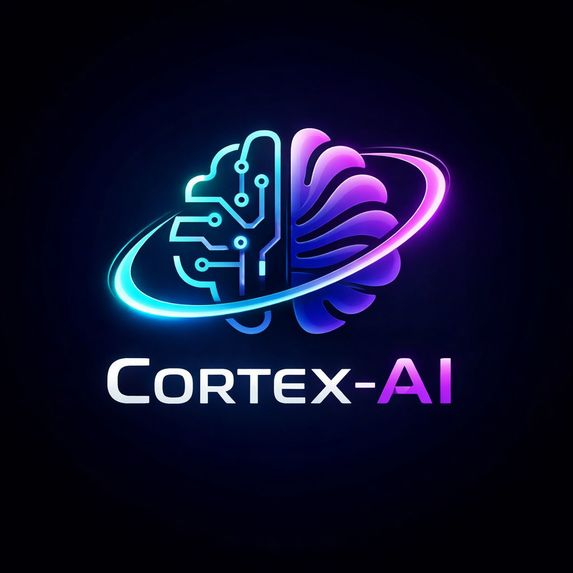
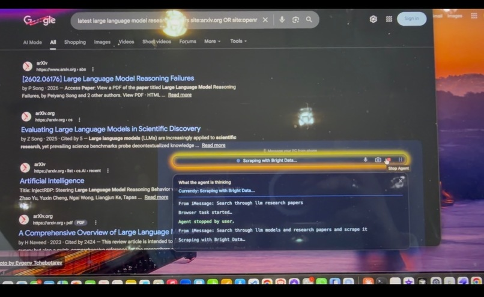
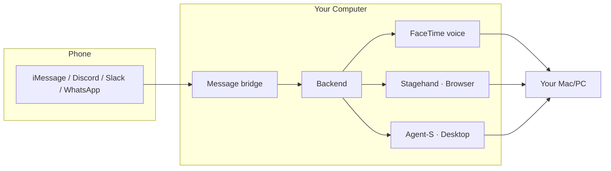

<p align="center">
  
</p>

<h1 align="center">Cortex-AI</h1>

<p align="center">
  <strong>Control your Mac or PC with AI</strong> — from your phone.
</p>

<p align="center">
  iMessage · Discord · Slack · WhatsApp · FaceTime voice
</p>

<p align="center">
  <a href="https://github.com/AdityaYC/Cortex-Treehacks">View on GitHub</a>
</p>

<p align="center">
  
  
  
</p>

---

## ✨ What it does

Send a message from your phone. Your computer does the rest.

| You send | Your Mac/PC does |
|----------|------------------|
| **"FaceTime me"** | Starts FaceTime, shares screen — then use **voice** to control the computer |
| **"Open Chrome and search X on Google"** | Opens Chrome, runs the search, opens the first result |
| **"Open Notepad"** | Opens Notepad and types a test message |
| **"Open Calculator"** | Opens the Calculator app |
| **"Go to YouTube Music and play some music"** | Opens Chrome, navigates to YouTube Music |

Only **your** messages are processed; everyone else is ignored.

---

## 🖼️ How it looks

<p align="center">
  
</p>

<p align="center"><em>Message from your phone → task runs on your computer. Architecture image generated by AI and made with love by Aditya Punjani and Sakshi Tripathy.</em></p>

---

## 🎬 Watch the demo

<p align="center">
  <a href="https://www.youtube.com/watch?v=dz8SoNqyDzA" target="_blank" rel="noopener">
    
  </a>
</p>

<p align="center">
  <strong><a href="https://www.youtube.com/watch?v=dz8SoNqyDzA" target="_blank" rel="noopener">▶ Watch on YouTube</a></strong>
</p>

---

## 🏗️ How it works



| Layer | Role |
|-------|------|
| **Message bridge** | Receives your messages (iMessage, Discord, Slack, WhatsApp). |
| **Backend** | Routes each message to the right service. |
| **FaceTime** | Text *"FaceTime me"* → call starts, screen shares; then use **voice** to control the Mac. |
| **Stagehand** | Browser tasks (Chrome, Google, YouTube, Gmail, etc.). |
| **Agent-S** | Desktop tasks (Notepad, Calculator, files, apps). |

---

## 🚀 Quick start

### Mac (iMessage + FaceTime)

```bash
git clone https://github.com/AdityaYC/Cortex-Treehacks.git
cd Cortex-Treehacks
cp .env.example .env   # Add API keys, FACETIME_APPLE_ID, etc.
./run_order.sh
```

Then text your Mac from iMessage. Say **"FaceTime me"** for a call + screen share and voice control, or send any other task (browser or desktop).

### Windows

```powershell
git clone https://github.com/AdityaYC/Cortex-Treehacks.git
cd Cortex-Treehacks
copy .env.example .env
.\run_windows.ps1
```

This starts the message bridge, backend, Agent-S, Stagehand, and frontend.

---

## 📱 Message your Mac/PC

| Platform | ngrok? | Setup |
|----------|--------|-------|
| **iMessage** (Mac) | No | Run with `run_order.sh`; text from your iPhone to trigger tasks and *"FaceTime me"* for voice |
| **Discord** | No | [Discord & Slack setup →](docs/DISCORD_SLACK_SETUP.md) |
| **Slack** | No | [Discord & Slack setup →](docs/DISCORD_SLACK_SETUP.md) |
| **WhatsApp** | Yes | [WhatsApp setup →](docs/WHATSAPP_SETUP.md) |

---

## 🔑 Required API keys

Add to `.env`:

```env
# Agent-S (required)
ANTHROPIC_API_KEY=sk-ant-your-key

# Stagehand (browser tasks)
OPENAI_API_KEY=sk-your-openai-key

# Discord / Slack / WhatsApp — see setup docs
```

---

## 📁 Project structure

| Folder | Purpose |
|--------|---------|
| `Agent-S` | Desktop automation (vision + pyautogui) |
| `backend` | Flask server, message bridges, Stagehand service |
| `frontend` | Electron UI |
| `docs` | Setup guides (Discord, Slack, WhatsApp, testing) |
| `scripts` | Utilities and run scripts |

---

## 📚 Documentation

| Doc | Description |
|-----|-------------|
| [Video calls & FaceTime](docs/VIDEO_CALL_SETUP.md) | *"FaceTime me"*, Zoom, Meet, WhatsApp |
| [Windows setup](docs/WINDOWS_ONLY_SETUP.md) | Full Windows-only setup |
| [Discord & Slack](docs/DISCORD_SLACK_SETUP.md) | Bot tokens and allowed user IDs |
| [WhatsApp (Twilio)](docs/WHATSAPP_SETUP.md) | Twilio and ngrok |
| [Testing](docs/TESTING.md) | How to test messages and flows |

---

## 🙏 Credits

- **Cortex-AI** — Logo and architecture imagery generated by AI and made with love by **Aditya Punjani** and **Sakshi Tripathy**.
- **[Agent-S](https://github.com/simular-ai/Agent-S)** — computer-use agent (simular-ai)
- **[Stagehand](https://github.com/browserbase/stagehand)** — browser automation (browserbase)

---

<p align="center"><sub>Last updated: February 2026</sub></p>
